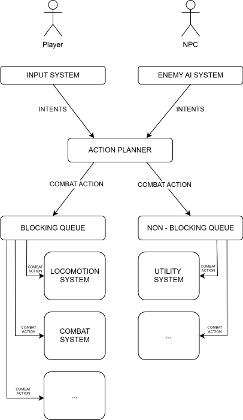

<h1 align="center">⚔️ A-RPG COMBAT DEMO</h1>

<h4 align="center">⬇️ CLICK BELOW TO WATCH VIDEO OVERVIEW ⬇️</h4>

[](https://www.youtube.com/watch?v=Py_NU5Jt9Zc)

---

### 📌 Developer Notes

* **Stack:** C17, Custom ECS, Raylib, Mixamo characters and animations.
* **Decoupled Model Loading:** Mixamo models and animations are loaded with `src/asset/raylib/raylib_model_manager.h` and mapped with components using IDs.
* **Action Planner:** A system that reads intents from player input `input_system` and/or `enemy_ai_system` and outputs `Action` via `BlockingActionQueue` or `NonBlockingActionQueue`.
  * **BlockingActionQueue** is a queue for blocking actions like `CHARACTER_ACTION_ATTACK` or `CHARACTER_ACTION_MOVE_TO_TARGET`. "Blocking" in this context means that only one `Action` can be performed at a time.
  * **NonBlockingActionQueue** is a queue for non-blocking actions like `CHARACTER_ACTION_USE_UTILITY`. Non-blocking actions are actions that can be performed in parallel with other tasks. For example: drink a potion while running.
  * **Abstract systems** like movement or collision systems do not rely on Actions. These systems rely on specific components.
  * **Character behavior systems** like `combat_system` or `locomotion_system` rely on queue tasks, but never try to validate if a task can be performed.
  * **Action Planner** is the primary system that validates if an intent can be performed in the current game context.
    * **Example:** The Action Planner resolves if the player CAN / SHOULD move to the target, and `locomotion_system` performs the task if it is in the queue.
  * **Action Planner** consumes intents → resolves the best possible action → puts the action into the queue → system reads the corresponding action → performs the action → removes the action from the queue.
* **Colliders:** The demo uses 2D flat ground colliders on the `X and Z` axes.
* **Hit Boxes:** Entities with `trigger colliders`.
* **Prefab:** A factory / builder script. A primary source of truth on how an Entity should be built and destroyed.
  * **Example:** `src/game/prefabs/brute_prefab.c`.
* **Skill Profile:** A factory / builder script for character combat skills.
  * **Example:** `src/game/profiles/brute_skills_profile.c`.
* **Combat Intent:** A primary source for combat-related data.
  * **Input System** sets `intent_slot_b` (blocking combat action) or `intent_slot_nb` (non-blocking combat action).
  * **Combat Slot** is a virtual slot that can be assigned to any combat skill.
    * assign combat action : `combat_intent_comp->actions[COMBAT_SLOT_W] = a_w`
    * assign animation : 
    ```c++ 
    const CharacterAnimationMap anim_map_comp = {
        .attack_animations = {
            [COMBAT_SLOT_W] = {
                .animation_set_id = w_attack_anim_set_id,
                .frame_count = w_attack_anim_frame_count
            },
        }
    };
    ```
* **Render 3D:** `AnimatedRender3D` for animated 3D models and `StaticRender3D` for static ones.
* **Animation Map:** `CharacterAnimationMap` contains all character-related animations. It also maps attack/utility animations to a specific `CombatSlot`.

---

<div align="center">
  
</div>

---

### 🙏 Credits

Built with [raylib](https://www.raylib.com/) by [@raysan5](https://github.com/raysan5).
